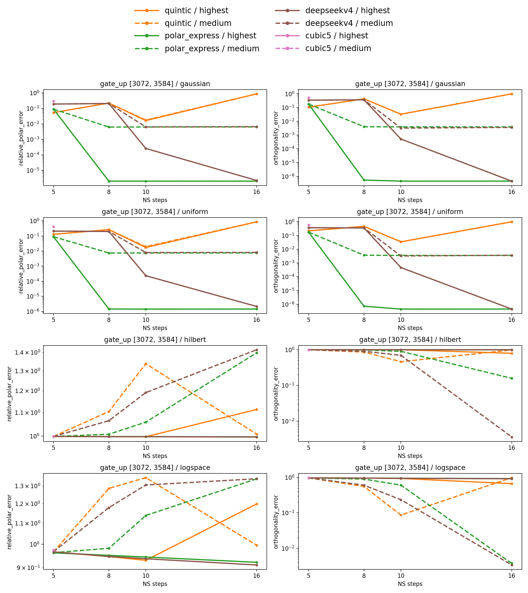

# Newton–Schulz quality

## Run settings

| Setting | Value |
| --- | --- |
| Matrix shape | `(3072, 3584)`. From Kimi-K3 MoE layers |
| Inputs | FP32 Gaussian `N(0, 1)`, uniform `[0, 1)`, Hilbert, and dense logspace |
| Logspace input | `U @ diag(s) @ V.T`; independent Gaussian QR factors `U`, `V`; `s` logarithmically spaced from `1e-30` to `1e10`; FP64 reconstruction cast to FP32 |
| Steps | 5, 8, 10, 16; `cubic5` at 5 only |
| NS precision | FP32 (`highest`) and BF16 (`medium`); FP32 normalization and returned output |
| BF16 reduced-precision reduction | `torch.backends.cuda.matmul.allow_bf16_reduced_precision_reduction = False` |
| Reference | `torch.linalg.polar` in FP64 on the transposed input; factor transposed back |

```bash
python -m benchmarks.newton_schulz_quality \
  --steps=5,8,10,16 --spectra=gaussian,uniform,hilbert,logspace \
  --output=/tmp/newton-schulz-quality.json \
  --plot=/tmp/newton-schulz-quality.png
```

## Results

Dense logspace input after FP32 conversion: measured singular values `1.54` to `1e+10`, condition number `6.47e+09`.

For NS output `X` and reference `Q`:

$$
\begin{aligned}
\text{Relative polar error} &= \frac{\lVert X-Q\rVert_F}{\lVert Q\rVert_F} \\
\text{Orthogonality error} &= \frac{\lVert XX^T-I_{3072}\rVert_F}{\sqrt{3072}}
\end{aligned}
$$


